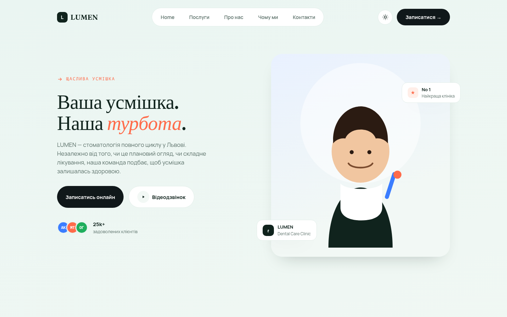
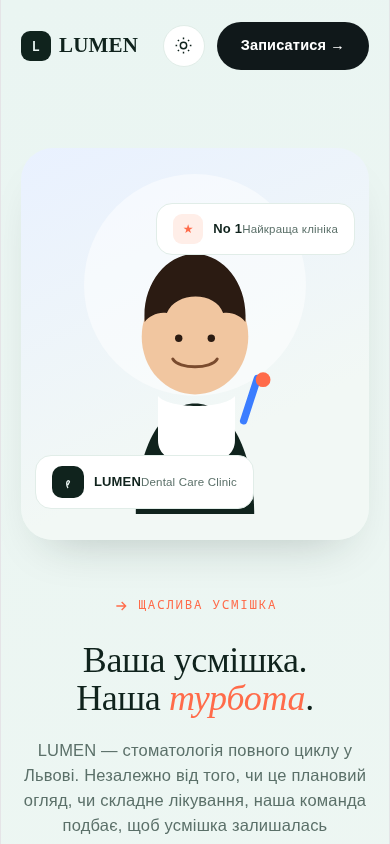

# LUMEN — лендинг стоматологічної клініки

**Демо:** https://lumen-dental-xi.vercel.app

Односторінковий сайт для стоматологічної клініки: послуги, етапи лікування,
команда лікарів, відгуки пацієнтів і форма онлайн-запису. Є перемикач
світлої та темної теми й адаптивна верстка під телефони.



<p align="center"></p>

## Можливості

- Світла / темна тема одним натисканням
- Адаптивна верстка: десктоп, планшет, телефон
- Плавна поява секцій під час прокрутки (`IntersectionObserver`)
- Секції: головний екран, послуги, етапи лікування, команда, відгуки, запис
- Форма запису з вибором послуги
- Без UI-бібліотек: усі стилі та SVG-іконки написані вручну

## Технології

React 19 · Vite · CSS (custom properties) · SVG

## Запуск

```bash
npm install
npm run dev      # режим розробки
npm run build    # збірка в папку dist/
```

## Структура

```
src/
├── DentalLanding.jsx   # уся сторінка: розмітка, дані, стилі
├── App.jsx
└── main.jsx
```

Тексти послуг, команди та відгуків зберігаються в масивах на початку
`DentalLanding.jsx`, тому їх легко замінити під іншу клініку.
